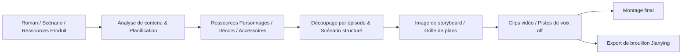

<h1 align="center">
  <br>
  <picture>
    <source media="(prefers-color-scheme: light)" srcset="docs/assets/logo-animated-light.svg">
    <source media="(prefers-color-scheme: dark)" srcset="frontend/public/logo-animated.svg">
    
  </picture>
  <br>
  ArcReel
  <br>
</h1>

<p align="center">
  <strong>Espace de travail open source et auto-hébergé pour la production vidéo par IA</strong>
  <br>
  Transformez des romans, des scénarios aboutis ou des ressources produits en vidéos courtes avec cohérence des personnages, contrôle du processus, suivi des coûts et éditabilité totale.
</p>

<p align="center">
  <a href="README.md"></a>
  <a href="README.en.md"></a>
  <a href="README.fr.md"></a>
</p>

<p align="center">
  <a href="https://github.com/ArcReel/ArcReel/releases/latest"></a>
  <a href="https://github.com/ArcReel/ArcReel/actions/workflows/test.yml"></a>
  <a href="https://codecov.io/gh/ArcReel/ArcReel"></a>
  <a href="https://hub.docker.com/r/arcreel/arcreel"></a>
  <a href="LICENSE"></a>
  <a href="https://github.com/ArcReel/ArcReel"></a>
</p>

<p align="center">
  <a href="#démarrage-rapide"><strong>Démarrage rapide</strong></a>
  ·
  <a href="docs/GUIDE_100_LOCAL.fr.md"><strong>Guide Studio 100% Local</strong></a>
  ·
  <a href="https://docs.arc-reel.com/guide/getting-started">Guide de prise en main</a>
  ·
  <a href="https://docs.arc-reel.com/">Documentation complète</a>
  ·
  <a href="#communauté">Rejoindre la communauté</a>
</p>

<p align="center">
  
</p>

## Sponsors

> [Vous souhaitez apparaître ici ?](mailto:support@arc-reel.com)

<table>
  <tr>
    <td width="200" align="center" valign="top">
      <a href="https://metaso.cn/minimax-h3/?s=arc"></a>
    </td>
    <td valign="top">
      <strong>API de génération vidéo MiniMax H3 | Metaso</strong><br>
      Metaso propose la génération vidéo MiniMax H3 à tarif avantageux : <strong>0,09 CNY/sec en 768P, 0,15 CNY/sec en 2K</strong>. Qualité 2K native, audio et vidéo synchronisés, API compatible protocole <strong>OpenAI</strong> et intégration <strong>ComfyUI</strong> — sans déploiement GPU nécessaire.<br>
      🎁 <a href="https://metaso.cn/minimax-h3/?s=arc">Inscrivez-vous via le lien exclusif ArcReel</a> pour recevoir des crédits bonus et une réduction exclusive.
    </td>
  </tr>
  <tr>
    <td width="200" align="center" valign="top">
      <a href="https://ofox.ai/?utm_source=github&utm_medium=sponsorship&utm_content=arcreel"></a>
    </td>
    <td valign="top">
      <strong>OfoxAI : APIs de modèles pour scénarios, images et vidéos</strong><br>
      Accédez aux modèles de texte, d'image et de vidéo via OfoxAI. Choisissez les capacités pour affiner vos scénarios, concevoir vos personnages et décors de référence, et générer vos séquences vidéo.<br>
      <a href="https://ofox.ai/?utm_source=github&utm_medium=sponsorship&utm_content=arcreel">Découvrir les modèles et APIs OfoxAI →</a>
    </td>
  </tr>
  <tr>
    <td width="200" align="center" valign="top">
      <a href="https://go.apimart.ai/tw-arcreel"></a>
    </td>
    <td valign="top">
      <strong>APIMart : API économique pour la génération IA d'images et de vidéos</strong><br>
      Merci à APIMart pour son parrainage ! APIMart est une plateforme d'API économique pour la génération d'images et vidéos IA — <strong>GPT-Image-2 dès 0,006 $ par image, plus de 160 images par dollar</strong>. Une API asynchrone unifiée couvre l'image et la vidéo. Traitez des dizaines de milliers d'images par lot sans timeout, changez de modèle sans réécrire votre code. Paiement à l'usage sans abonnement mensuel — <a href="https://go.apimart.ai/tw-arcreel">inscrivez-vous ici</a> pour commencer.
    </td>
  </tr>
</table>

## Captures d'écran

<table>
  <tr>
    <td width="50%"></td>
    <td width="50%"></td>
  </tr>
  <tr>
    <td width="50%"></td>
    <td width="50%"></td>
  </tr>
</table>

## Exemples de réalisation

<div align="center">
  <video src="https://github.com/user-attachments/assets/fcc4ceb2-64dd-44a0-a32c-e0c00b2f9796" width="100%" controls></video>
</div>

> Épisode 1

<div align="center">
  <video src="https://github.com/user-attachments/assets/d6bfe589-a5c0-4961-8bfe-b7b59be3bb8a" width="100%" controls></video>
</div>

> Épisode 2

<div align="center">
  <video src="https://github.com/user-attachments/assets/1e580769-80f7-4d14-b46d-68569b6e7e4c" width="100%" controls></video>
</div>

> Épisode 3

## Qu'est-ce qu'ArcReel ?

ArcReel est un environnement de travail open source et auto-hébergé conçu pour l'adaptation de romans et fictions dramatiques par IA, les vidéos courtes avec voix off, les publicités et les démonstrations de produits. Il structure l'analyse de contenu, la gestion d'actifs, le storyboarding, la génération multimédia, le suivi budgétaire et l'export dans une chaîne de production entièrement inspectable et résiliente aux interruptions.

- **Un pipeline de production unifié** : transformez pas à pas romans, scénarios ou ressources produits en fiches personnages, décors, accessoires, plans de storyboard, clips vidéo et film final.
- **Continuité visuelle sous contrôle humain** : réutilisez les ressources de référence à travers les plans, validez chaque étape clé, régénérez individuellement les éléments non satisfaisants et revenez aux versions précédentes.
- **Gestion des modèles et maîtrise des coûts** : configurez au même endroit vos modèles de texte, d'image, de vidéo et de synthèse vocale (TTS), puis consultez les estimations et les coûts réels consommés.
- **Livrables éditables** : effectuez le rendu direct de la vidéo finale ou exportez des brouillons Jianying pour peaufiner sous-titres, voix off, rythme et transitions (export conçu pour Jianying Chine continentale ; compatibilité CapCut non garantie).

## Du texte brut à la vidéo finale



Chaque étape peut être orchestrée automatiquement par l'Agent, ou inspectée, ajustée et relancée manuellement par le créateur. Consultez le guide [Flux de travail et modes](https://docs.arc-reel.com/guide/workflows) pour choisir le mode adapté à votre projet.

## Démarrage rapide

Installez Docker et Docker Compose, puis exécutez :

```bash
git clone https://github.com/ArcReel/ArcReel.git
cd ArcReel/deploy

cp .env.example .env
docker compose up -d
```

Ouvrez <http://localhost:1241>. L'identifiant par défaut est `admin`. Si la variable `AUTH_PASSWORD` est vide, ArcReel génère automatiquement un mot de passe au premier démarrage et l'enregistre dans `deploy/.env`.

> Par défaut, Docker Compose publie le port `1241` sur toutes les interfaces réseau de la machine. N'exposez pas ArcReel directement sur Internet public sans protection. Avant tout accès distant, configurez l'authentification et utilisez un reverse proxy HTTPS, un VPN ou un tunnel sécurisé. Consultez [Reverse Proxy et HTTPS](https://docs.arc-reel.com/ops/deployment#reverse-proxy-and-https).

Une fois connecté, rendez-vous dans les **Paramètres**, configurez l'Agent ArcReel ainsi que les fournisseurs de texte, d'image, de vidéo et de voix off, puis créez votre premier projet.

Pour le guide complet de premier démarrage, consultez la [Prise en main](https://docs.arc-reel.com/guide/getting-started). Pour le déploiement en production, les mises à jour, sauvegardes et reverse proxies, consultez [Déploiement et Opérations](https://docs.arc-reel.com/ops/deployment).

## Documentation

| Page | Contenu |
|---|---|
| [Accueil de la documentation](https://docs.arc-reel.com/) | Portail pour utilisateurs, administrateurs et développeurs |
| [Prise en main](https://docs.arc-reel.com/guide/getting-started) | Du premier déploiement à votre première vidéo générée |
| [Flux de travail et modes](https://docs.arc-reel.com/guide/workflows) | Romans, scénarios et idées créatives ; 3 types de création et 2 modes de génération |
| [Configuration des fournisseurs](https://docs.arc-reel.com/guide/providers) | Choix et paramétrage des fournisseurs d'Agent, texte, image, vidéo et TTS |
| [Export de brouillon Jianying](https://docs.arc-reel.com/guide/jianying-export) | Poursuivre le montage dans Jianying |
| [FAQ](https://docs.arc-reel.com/guide/faq) | Questions fréquentes : déploiement, coûts, modèles, données et licence |
| [Déploiement et Exploitation](https://docs.arc-reel.com/ops/deployment) | SQLite, PostgreSQL, mises à jour, sauvegardes et reverse proxy |
| [Migration de SQLite vers PostgreSQL](https://docs.arc-reel.com/ops/migrate-to-postgres) | Procédure de migration des données, vérification et retour arrière |
| [Architecture](https://docs.arc-reel.com/dev/architecture) | Agent Runtime, file de tâches, abstraction de fournisseurs et couche de données |
| [Contribuer](https://docs.arc-reel.com/dev/contributing) | Développement local, suites de tests, conventions et Pull Requests |

## Communauté

Rejoignez la communauté ArcReel pour obtenir de l'aide, suivre les nouvelles versions et échanger sur les flux de travail :

<p align="center">
  
</p>

Les signalements de bugs reproductibles et les propositions de fonctionnalités sont les bienvenus sur [GitHub Issues](https://github.com/ArcReel/ArcReel/issues).

## Contribuer

Les contributions au code, à la documentation, aux tests et aux adaptateurs de fournisseurs sont vivement appréciées.

Lisez [CONTRIBUTING.md](CONTRIBUTING.md) (ou [CONTRIBUTING.fr.md](CONTRIBUTING.fr.md)) avant de commencer. Après avoir cloné le dépôt, installez les hooks git :

```bash
uv run pre-commit install
```

## Historique d'étoiles (Star History)

<a href="https://www.star-history.com/?repos=arcreel%2Farcreel&type=date&legend=top-left">
 <picture>
   <source media="(prefers-color-scheme: dark)" srcset="https://api.star-history.com/chart?repos=arcreel/arcreel&type=date&theme=dark&legend=top-left" />
   <source media="(prefers-color-scheme: light)" srcset="https://api.star-history.com/chart?repos=arcreel/arcreel&type=date&legend=top-left" />
   
 </picture>
</a>

## Licence et usage commercial

ArcReel est distribué sous licence [GNU Affero General Public License v3.0](LICENSE). Des conditions additionnelles sont précisées dans [NOTICE](NOTICE).

Pour les organisations ne pouvant pas utiliser l'AGPL-3.0, ou nécessitant un déploiement commercial, du white-labeling (marque blanche) ou une redistribution sans les obligations de l'AGPL, contactez :

**support@arc-reel.com**

Copyright © 2026 Pollo3470 et les contributeurs d'ArcReel

---

<p align="center">
  Si ArcReel vous est utile, n'hésitez pas à soutenir le projet avec une ⭐ Star !
</p>

