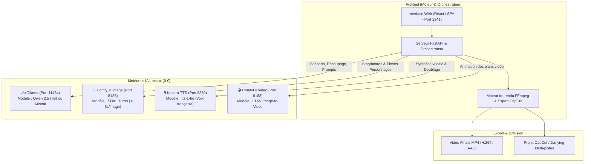

# 🎬 Guide Complet ArcReel : Studio Vidéo IA 100% Local & Gratuit
> **Zéro abonnement, zéro dépendance cloud, 100% privé et autonome.**  
> *Inclut les alternatives API / Cloud pour chaque composant.*

Ce guide détaille pas à pas la configuration complète d'un studio de production vidéo IA autonome avec **ArcReel**, depuis le clonage du dépôt jusqu'à l'exportation finale dans **CapCut**, optimisé en particulier pour **Apple Silicon (M1/M2/M3/M4)** et les PC avec GPU.

---

## 🏗️ Architecture Globale du Studio 100% Local



### La chaîne de production :
| Rôle | Outil Local Gratuit | Modèle conseillé | Option Cloud alternative |
| :--- | :--- | :--- | :--- |
| **✍️ Scénario & Copilot** | **Ollama** | `qwen2.5:7b` ou `mistral` | Claude 3.5 / DeepSeek V3 / OpenRouter |
| **🎨 Storyboard & Images** | **ComfyUI** | `SDXL Turbo` (ou Flux Schnell) | Google Imagen 3 / Fal.ai / Replicate |
| **🎙️ Voix off & Doublage** | **Kokoro-TTS** | `tts-1-hd` (voix studio FR) | Google Gemini TTS (Google AI Studio gratuit) |
| **🎬 Animation Vidéo** | **ComfyUI** | `LTXV Image-to-Video` | Kling AI / Vidu / Google Veo / Seedance |
| **✂️ Montage & Export** | **FFmpeg intégré** | H.264 / AAC / ASS Subtitles | Export natif CapCut / Jianying Pro |

---

## 📥 Étape 1 : Clonage et Lancement d'ArcReel

### 1.1 Cloner le dépôt
```bash
git clone https://github.com/jefferson1203/ArcReel-fr.git
cd ArcReel-fr
```

### 1.2 Préparer la configuration de production
Dans le dossier `deploy/production` :
```bash
cd deploy/production
cp .env.example .env 2>/dev/null || true
```

Éditez le fichier `.env` :
```dotenv
# Identifiants de connexion
AUTH_USERNAME=admin
AUTH_PASSWORD=votre_mot_de_passe_securise

# Clé secrète JWT (générée aléatoirement)
AUTH_TOKEN_SECRET=openssl_rand_hex_32_ici

# Mot de passe PostgreSQL (lettres et chiffres uniquement)
POSTGRES_PASSWORD=un_mot_de_passe_robuste_sans_caracteres_speciaux
```

### 1.3 Lancer les conteneurs avec compilation locale
Pour bénéficier de la version traduite en français :
```bash
docker compose up -d --build
```
> **Vérification :** Ouvrez votre navigateur sur **`http://localhost:1241`**. Connectez-vous avec vos identifiants. Dans **Paramètres > Général**, assurez-vous que la langue d'interface est bien configurée sur **Français**.

---

## ✍️ Étape 2 : Scénarios, Découpage et Prompts (Ollama)

### 2.1 Installer et lancer Ollama
1. Installez Ollama : téléchargez l'application sur [ollama.com](https://ollama.com) ou via Homebrew :
   ```bash
   brew install ollama
   ```
2. Téléchargez le modèle Qwen 2.5 (7B) (ou Mistral) :
   ```bash
   ollama pull qwen2.5:7b
   ```
3. Démarrez Ollama avec écoute sur le réseau pour que le conteneur Docker puisse l'atteindre :
   ```bash
   OLLAMA_HOST=0.0.0.0:11434 ollama serve
   ```
   *Test de bon fonctionnement :* `curl http://localhost:11434/v1/models` doit renvoyer la liste de vos modèles en JSON.

### 2.2 Connecter Ollama dans ArcReel
1. Allez dans **Paramètres > Fournisseurs > Ajouter un fournisseur personnalisé**.
2. Remplissez :
   * **Protocole :** `OpenAI`
   * **Nom :** `Ollama Local`
   * **Base URL :** `http://host.docker.internal:11434/v1`
   * **Clé API :** `ollama` (ou n'importe quel texte factice).
3. Cliquez sur **« Obtenir les modèles »** (Fetch Models).
4. Cochez **`qwen2.5:7b`** et activez la case **Texte**. Cliquez sur **Enregistrer**.
5. Allez dans **Paramètres > Modèles de médias** :
   * Section **Texte** : sélectionnez `Ollama Local / qwen2.5:7b` pour le modèle par défaut, les tâches simples et complexes.
   * Enregistrez en bas de page.

---

## 🎨 Étape 3 : Storyboards et Images (ComfyUI + SDXL Turbo)

### 3.1 Installer ComfyUI Desktop
1. Installez l'application officielle via Homebrew :
   ```bash
   brew install --cask comfy
   ```
   *(Ou téléchargez le `.dmg` officiel sur [comfy.org/download](https://comfy.org/download)).*
2. Lancez **Comfy Desktop** depuis votre dossier `/Applications`.
3. Cliquez sur **« Skip & Install »** si un assistant vous propose de lourds modèles de démarrage.
4. Dans le gestionnaire de modèles (**Manager / Models**), installez **SDXL-Turbo** (`sd_xl_turbo.safetensors`, environ 6,46 Go).
5. Ouvrez le workflow SDXL Turbo dans ComfyUI.

### 3.2 Exporter et importer le workflow
1. Dans ComfyUI, cliquez sur l'icône de réglages > **« Export (API) »** (ou cochez *Enable Dev mode Options* si besoin). Enregistrez le fichier sous `sdxl_turbo_api.json`.
2. Dans ArcReel, allez dans **Paramètres > Points de terminaison (Endpoints)** :
   * Cliquez sur **« Importer un workflow API »**.
   * Choisissez votre fichier `sdxl_turbo_api.json`.
   * Nom : `SDXL Turbo`
   * Type de média : **Image**.
   * Enregistrez le point de terminaison.
3. Dans **Paramètres > Fournisseurs > Ajouter un fournisseur** :
   * **Protocole :** `comfyui`
   * **Nom :** `ComfyUI Local`
   * **Base URL :** `http://host.docker.internal:8188`
   * **Clé API :** laisser vide.
   * Dans la liste des modèles en bas, cliquez sur `+` (Ajouter un modèle manuellement), sélectionnez le point de terminaison `SDXL Turbo` et cochez la case.
   * Enregistrez le fournisseur.
4. Dans **Paramètres > Modèles de médias > Image** : sélectionnez `SDXL Turbo` comme générateur d'image par défaut.

---

## 🎙️ Étape 4 : Voix off & Synthèse Vocale (Kokoro-TTS)

### 4.1 Lancer Kokoro-TTS via Docker
Dans le terminal de votre Mac :
```bash
docker run -d --name kokoro-tts -p 8880:8880 --restart unless-stopped ghcr.io/remsky/kokoro-fastapi-cpu:latest
```
*Test :* `curl http://localhost:8880/v1/models` doit retourner `tts-1`, `tts-1-hd` et `kokoro`.

### 4.2 Connecter Kokoro dans ArcReel
1. Allez dans **Paramètres > Fournisseurs > Ajouter un fournisseur**.
2. Remplissez :
   * **Protocole :** `OpenAI`
   * **Nom :** `Kokoro Local TTS`
   * **Base URL :** `http://host.docker.internal:8880/v1`
   * **Clé API :** `kokoro`
3. Cliquez sur **« Obtenir les modèles »**, cochez **`tts-1-hd`** (et/ou `tts-1`) et activez la case **Audio**. Enregistrez.
4. Dans **Paramètres > Modèles de médias > Audio** :
   * Définissez le fournisseur audio par défaut sur `Kokoro Local TTS / tts-1-hd`.
   * Enregistrez.

> **💡 Alternative Cloud (Google Gemini TTS) :**  
> Si vous préférez des voix studio prêtes à l'emploi sans lancer de conteneur audio : rendez-vous sur [aistudio.google.com](https://aistudio.google.com), créez une clé API gratuite et collez-la sous **Paramètres > Fournisseurs > Gemini**. Gemini TTS propose 30 voix d'un réalisme saisissant en français.

---

## 🎬 Étape 5 : Animation Vidéo (ComfyUI + LTX-Video)

### 5.1 Charger le modèle LTX-Video dans ComfyUI
1. Dans Comfy Desktop, recherchez dans les templates vidéo : **`LTXV Image vers Vidéo`** (la carte avec le renard dans la neige).
2. Cliquez sur **Ouvrir / Installer**.
3. Cliquez sur **« Tout télécharger (15.02 GB) »** pour récupérer les deux composants officiels :
   * `ltx-video-2b-v0.9.5.safetensors` (5,91 Go)
   * `t5xxl_fp16.safetensors` (9,12 Go)

### 5.2 Exporter et connecter le workflow vidéo
1. Une fois les téléchargements terminés, exportez le workflow API : menu > **« Export (API) »** > enregistrez sous `ltxv_video_api.json`.
2. Dans ArcReel, allez dans **Paramètres > Points de terminaison** :
   * Cliquez sur **« Importer un workflow API »**.
   * Chargez `ltxv_video_api.json`.
   * Nom : `LTX Video Local`
   * Type de média : **Vidéo**.
   * Enregistrez.
3. Dans **Paramètres > Fournisseurs > ComfyUI Local** :
   * Ajoutez une nouvelle ligne de modèle avec le point de terminaison `LTX Video Local`.
   * Cochez la case **Vidéo** et enregistrez.
4. Dans **Paramètres > Modèles de médias > Vidéo** :
   * Sélectionnez `LTX Video Local` comme modèle de vidéo par défaut.
   * Enregistrez.

> **💡 Alternative Cloud (Vidéos ultra-rapides) :**  
> Si vous ne souhaitez pas attendre le calcul local (environ 2 à 4 minutes par plan sur Mac M3 Pro), vous pouvez ajouter une clé pour **Kling AI**, **Vidu** ou **Google Veo** pour générer les plans vidéo finaux dans le cloud en quelques secondes.

---

## ✂️ Étape 6 : Montage Final et Export CapCut

Lorsque votre épisode est terminé et que tous vos plans sont validés sur la timeline d'ArcReel, cliquez sur le bouton de rendu/export :

### Option 1 : Rendu direct MP4 haute fidélité (FFmpeg)
* Choisissez **« Montage final »**.
* Options : activez ou non l'incrustation des sous-titres (`Burned Subtitles` via `libass`) et la présence de la voix off.
* Cliquez sur **Rendre le montage final** : ArcReel concatène les plans, mixe la musique BGM, cale la voix off avec limiteur audio (−1 dBFS) et produit un fichier `.mp4` (H.264 / AAC 48 kHz, `+faststart`) prêt à être publié.

### Option 2 : Poursuivre le montage dans CapCut (Brouillon Jianying)
* Choisissez **« Brouillon Jianying »**.
* Indiquez le chemin de votre dossier de projets CapCut sur macOS :
  ```text
  /Users/<VotreNomUtilisateur>/Movies/CapCut/User Data/Projects/com.lveditor.draft
  ```
* Choisissez la version **v6+**.
* Téléchargez l'archive ZIP générée et décompressez-la directement dans votre dossier `com.lveditor.draft`.
* Ouvrez **CapCut** : le projet apparaît instantanément dans vos projets récents avec toutes les pistes séparées (vidéos découpées, pistes voix off indépendantes, musiques et sous-titres vectoriels modifiables).

---

## ⚙️ Configuration Indispensable : Rendre les Moteurs Locaux Utilisables par Docker

Pour que les services locaux (Ollama, ComfyUI, Kokoro) puissent communiquer sans accroc avec ArcReel exécuté sous Docker, voici les **règles d'or techniques** à respecter impérativement :

### 1. Le pont réseau `host.docker.internal` (Pourquoi `localhost` ne fonctionne pas)
* **Le problème :** À l'intérieur d'un conteneur Docker, `localhost` (ou `127.0.0.1`) fait référence au conteneur lui-même, et non à votre Mac. Si vous écrivez `http://localhost:11434`, ArcReel cherche Ollama à l'intérieur du conteneur et échoue avec `Connection refused`.
* **La solution :** Utilisez toujours le nom de domaine spécial **`host.docker.internal`** dans les URLs de vos fournisseurs dans ArcReel :
  * Ollama : `http://host.docker.internal:11434/v1`
  * ComfyUI : `http://host.docker.internal:8188`
  * Kokoro : `http://host.docker.internal:8880/v1`

---

### 2. Ouvrir Ollama aux connexions Docker (`OLLAMA_HOST=0.0.0.0`)
* **Le piège :** Par défaut sur macOS, l'application Ollama écoute exclusivement sur `127.0.0.1`. Comme les requêtes de Docker arrivent depuis le sous-réseau interne de la machine virtuelle Docker (ex: `192.168.65.x`), macOS bloque la connexion par sécurité.
* **La solution obligatoire :**
  Démarrez Ollama avec la variable `OLLAMA_HOST="0.0.0.0:11434"` :
  ```bash
  OLLAMA_HOST=0.0.0.0:11434 ollama serve
  ```
  > **💡 Astuce permanente sur Mac :** Pour que l'application Ollama.app écoute toujours sur `0.0.0.0` même lancée via le menu, tapez une fois dans votre terminal :
  > ```bash
  > launchctl setenv OLLAMA_HOST "0.0.0.0:11434"
  > ```
  > Puis relancez Ollama.

---

### 3. La règle d'or ComfyUI dans ArcReel (Éviter l'erreur *« Au moins un modèle doit être activé »*)
* **Le piège :** ComfyUI n'a pas d'API de découverte de modèles standard (`/v1/models`). Dans ArcReel, **un modèle = un fichier workflow importé**. Si vous essayez d'enregistrer le fournisseur ComfyUI sans avoir de modèle attaché, l'enregistrement échoue.
* **L'ordre obligatoire à respecter :**
  1. Dans ComfyUI, faire **« Export (API) »** (et non l'export classique de graphe) pour obtenir le fichier JSON avec les identifiants de nœuds.
  2. Dans ArcReel, aller **D'ABORD** dans **Paramètres > Points de terminaison (Endpoints)** et cliquer sur **« Importer un workflow API »**.
  3. **ENSUITE SEULEMENT**, aller dans **Paramètres > Fournisseurs > ComfyUI Local**, cliquer sur `+` (Ajouter un modèle manuellement), sélectionner le point de terminaison nouvellement importé et **cocher sa case**.
  4. Enregistrer : l'erreur disparaît.

---

### 4. Le démarrage de Kokoro-TTS (Éviter l'erreur `Connection reset`)
* **Le piège :** Au tout premier lancement ou après un redémarrage, Kokoro charge en mémoire ses poids de synthèse vocale ONNX (cold start d'environ 5 à 10 secondes). Si vous envoyez une requête ou testez la connexion immédiatement, le serveur réinitialise la socket avec `curl: (56) Recv failure: Connection reset`.
* **La solution :**
  Vérifiez les journaux du conteneur avant de tester :
  ```bash
  docker logs kokoro-tts
  ```
  Dès que vous voyez `INFO: Application startup complete`, le service est prêt à synthétiser des voix à pleine vitesse.

---

### 5. Gestion de la mémoire unifiée sur Apple Silicon (18 Go de RAM)
* **Les modèles légers recommandés :**
  * Texte : **Qwen 2.5 7B** (~4,7 Go) ou **Mistral 7B** (~4,3 Go)
  * Image : **SDXL Turbo** (~6,46 Go)
  * Voix : **Kokoro-82M** (~300 Mo)
  * Vidéo : **LTXV Image-to-Video** (~5,9 Go)
* **Les modèles à éviter sur une machine de 18 Go :**
  * Évitez les modèles bruts de plus de 15-20 Go comme *MOSS-Image* (21 Go) ou *MiniMax H3* (53 Go) dans ComfyUI, car ils déclencheront du swap mémoire intensif et gèleront votre machine. Privilégiez toujours les variantes distillées ou quantifiées.

---

## 🚀 Démarrage en 1 clic (Script automatique)

Pour vous éviter de lancer chaque service manuellement dans des terminaux séparés à chaque session de travail, le projet inclut un script d'automatisation complet :

```bash
bash scripts/start-local-studio.sh
```

Ce script vérifie et démarre automatiquement dans l'ordre :
1. ✅ **Docker Desktop**
2. ✍️ **Ollama** configuré sur `0.0.0.0:11434`
3. 🎙️ **Kokoro-TTS** (démarre le conteneur Docker sur le port 8880)
4. 🎨 **Comfy Desktop** sur le port 8188
5. 🖥️ **ArcReel** (lance la stack Docker de production sur le port 1241)

---

## 🌐 Tableau Récapitulatif des Connexions Réseau (Docker)

Comme ArcReel s'exécute à l'intérieur d'un conteneur Docker, il communique avec les services hôtes via **`host.docker.internal`** :

| Service | Port sur le Mac | Adresse configurée dans ArcReel | Protocole ArcReel |
| :--- | :--- | :--- | :--- |
| **✍️ Ollama (Texte)** | `11434` | `http://host.docker.internal:11434/v1` | `OpenAI` |
| **🎨 ComfyUI (Images)** | `8188` | `http://host.docker.internal:8188` | `comfyui` |
| **🎙️ Kokoro (Audio)** | `8880` | `http://host.docker.internal:8880/v1` | `OpenAI` |
| **🎬 ComfyUI (Vidéo)** | `8188` | `http://host.docker.internal:8188` | `comfyui` |
| **🖥️ ArcReel Web UI** | `1241` | `http://localhost:1241` (dans Safari/Chrome) | HTTP Web |

---

## 🛠️ Commandes Utiles & Maintenance

* **Démarrer tout le studio en 1 clic :**
  ```bash
  bash scripts/start-local-studio.sh
  ```
* **Redémarrer le serveur ArcReel uniquement :**
  ```bash
  cd deploy/production && docker compose restart arcreel
  ```
* **Voir les journaux de Kokoro-TTS :**
  ```bash
  docker logs -f kokoro-tts
  ```
* **Vérifier l'état d'Ollama :**
  ```bash
  curl http://localhost:11434/api/tags
  ```
* **Reconstruire ArcReel après une modification de code ou de traduction :**
  ```bash
  cd deploy/production && docker compose up -d --build
  ```
